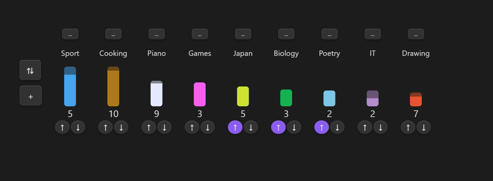

# Obsidian Multitask Tracker

Do you have a lot of interests that you want to keep track of to get a full picture what you are doing? Are you tired of forgetting about your various hobbies? Then this plugin for [Obsidian](https://obsidian.md/) is exactly what you need!



## What it does

- **Visual Tracking:** Create colorful blocks representing your interests and set a day count (how long it takes to drop from max productivity to zero).
- **Easy Sorting:** Sort your tasks by size, last update and alphabet.
- **Custom Layouts:** Move blocks around to create a custom visualizations of your interests.
- **Automatic Decay:** Once you check a task, its progress will automatically decrease every day unless you check it again. Blocks update every 24 hours * drop periodicity (reload the note to see the changes). Blocks that dropped today will play a falling animation when you open the page.
- **Drop Periodicity**: Set how often task will drop with "step" setting, so you can work in your pace for every hobby individually without loosing productivity progress.
- **Grace Period:** After check there is a 1-day grace period where it stays full and is clearly marked, so you won't forget to check it today.
- **English and Russian**: chose preferable language!

## Getting Started

Create a code block like below in any note:

~~~
```multitask

```
~~~

Now click the `+` button and start creating your tasks!

### Customization 

#### Language 

You can choose russian language by creating block like this:

~~~
```multitask
{
  "habits": [],
  "setting": {
    "lang": "ru"
  }
}
```
~~~


